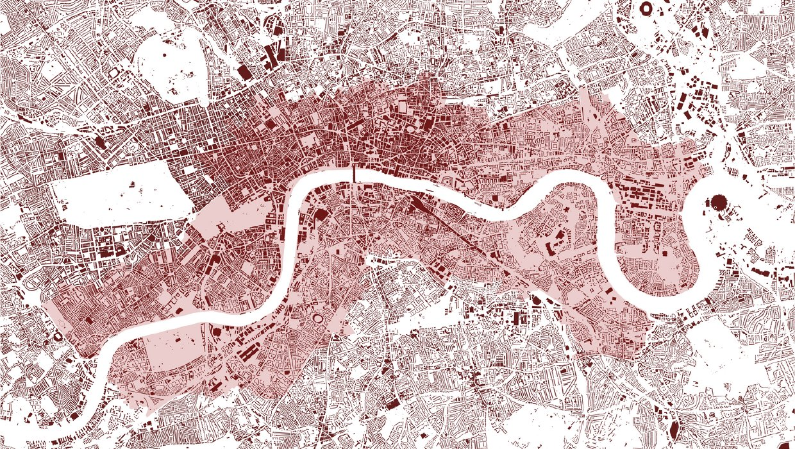
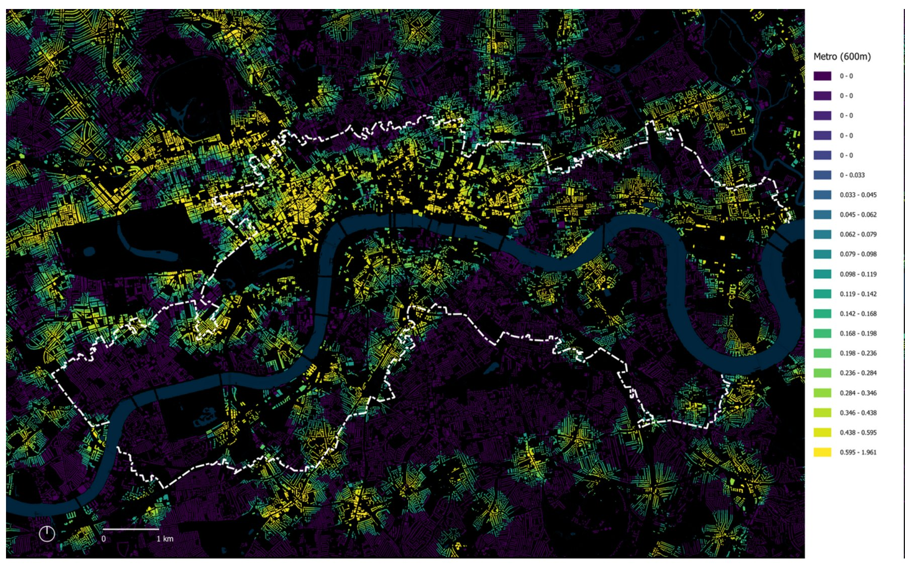
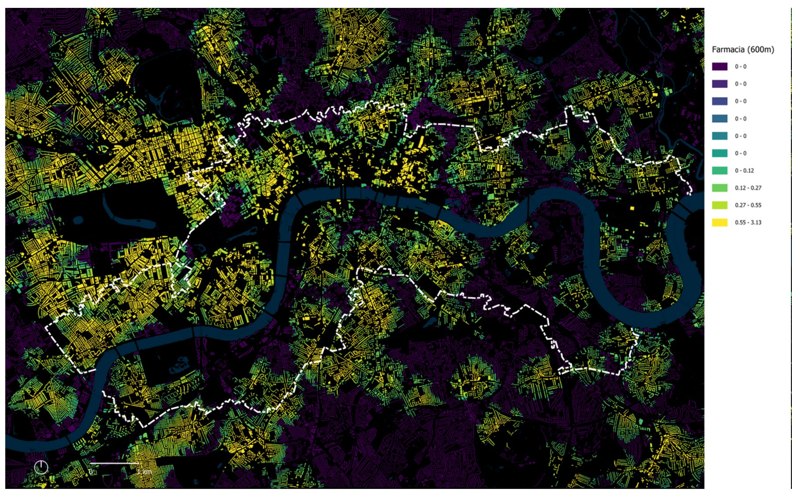

Rivers shape cities, and they also split them. In London the Thames is the city's spine, yet the two banks grew up very differently. My final project for the Bachelor's degree in Architecture at ETSAB (UPC) asked a simple question about that split: **does where you live, north or south of the river, change how much of daily life you can reach on foot?**

To answer it I used the **15-minute city** as a yardstick. The idea is that homes, transport, green space and everyday services should all sit within a short walk.

## The hypothesis

*Neighbourhoods on the south bank of the Thames have lower proximity levels, under the 15-minute city model, than neighbourhoods on the north bank.*

## The study area

London covers more than 1,500 km² and over nine million people, so I focused on the central 15 km of the river and a 1 km band along each bank. That gives an area of 62 km² and about 540,000 residents, roughly the size of Barcelona's urban fabric laid over central London.

The two halves are very different. The north bank is larger and less dense (about 7,000 residents/km²). The south bank packs more people into less land (about 12,400 residents/km²).

<small>Study area: a 1 km band on each bank along 15 km of the Thames</small>

## How I measured it

The method follows the walk from each home to the services around it, measured along the real street network rather than as straight lines:

- **Data.** Residents from the Office for National Statistics; residential buildings and services from OpenStreetMap.
- **Thresholds.** 600 m (about a 10-minute walk) and 900 m (about 15 minutes).
- **Destinations.** Three groups: public transport (Underground and bus), green spaces, and essential services (supermarkets, pharmacies, libraries and civic centres).
- **Tools.** QGIS to clean the data and lay out the maps, and Rhino with the Urban Network Analysis plug-in to calculate reach and closest-facility distances for every residential building.

## What the maps show

| Share of residents within walking distance | North bank | South bank |
| --- | --- | --- |
| Underground station, 900 m | 90% | 76% |
| Underground station, 600 m | 60% | 49% |
| Bus stop, 600 m | 100% | 100% |
| 40 or more transport stops in reach | 32% | 13% |
| Park, 600 m | 95% | 96% |
| Supermarket, 600 m | 99.5% | 99% |
| Pharmacy, 600 m | 80% | 65% |
| Library or civic centre, 600 m | 59% | 53% |

<small>Access to Underground stations within 600 m. Yellow buildings reach the most stations.</small>

The hypothesis holds. The north bank does better on almost every count, and the gap is widest for the Underground and for pharmacies. Buses and supermarkets cover both banks almost completely, so they flatten the difference.

Green space is the exception: the south bank is slightly better served. Its later growth seems to have kept more parks and open land.

<small>Access to pharmacies within 600 m</small>

## Why density alone does not explain it

The south bank is denser, yet it is less well served. Density does not explain this, but history and daily flows do. The north bank consolidated first, around the City and Westminster, and it still draws most of London's commuters and visitors. Services follow those people. Reading the numbers next to the city's history explained more than either would on its own.

## What I took from it

- **Measure first, then design.** A clear, repeatable method shows exactly where a neighbourhood falls short and by how much, before anyone draws a line.
- **Context matters.** Maps tell you *where*; history and urban form tell you *why*.
- **Next step: design.** The natural follow-up is to look at the areas with the weakest results, read them by population group (older people, families with children) and propose small-scale interventions to close the gaps.

This project is where I started combining architecture and urban design with spatial analysis, and that approach still guides my work today.

*Final project, Bachelor's degree in Architecture, ETSAB, Universitat Politècnica de Catalunya. Supervised by Francesc Valls Dalmau.*
